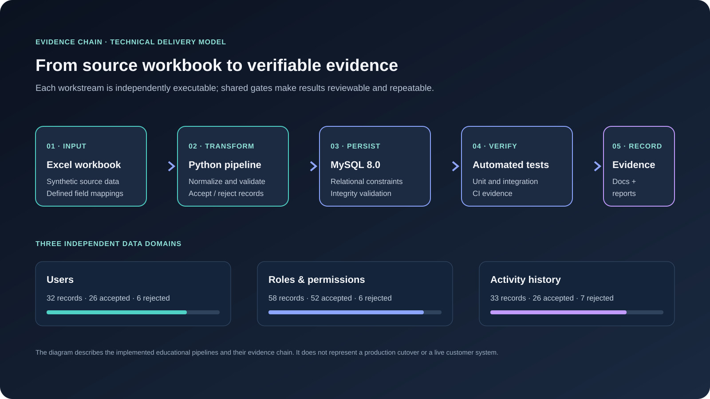
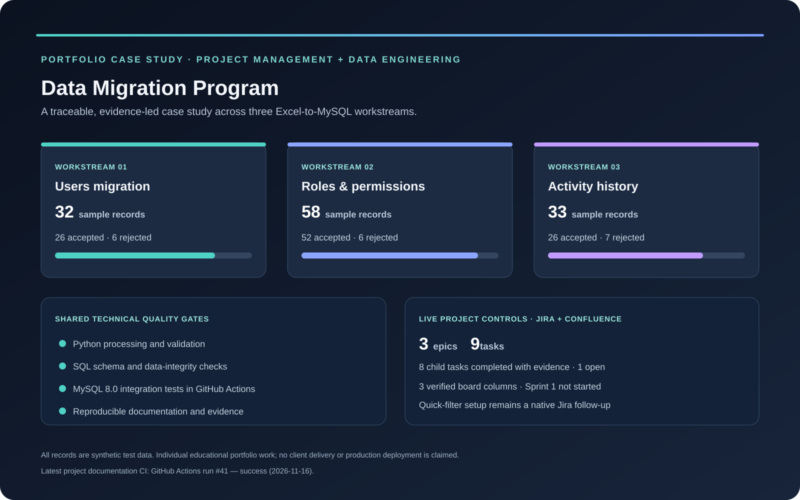
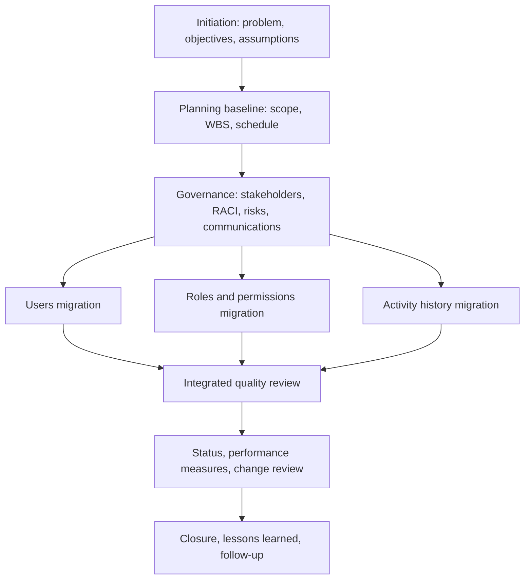
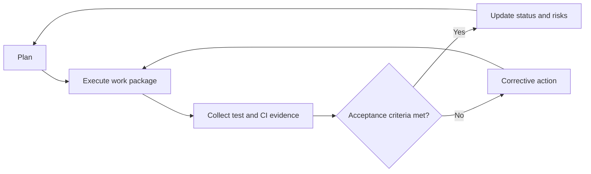

# Delivery Map and Dependencies

This diagram shows the proposed governance-to-delivery relationship. It is a model of the case study, not a timestamped historical execution log.

## Workstream quality gates

| Gate | Required evidence | Decision |
|---|---|---|
| G1 — Requirements | Source assumptions, mappings, scope, acceptance rules | Proceed only when rules are explicit |
| G2 — Build | Transformations, schema, tests, reproducible input | Ready for integration validation |
| G3 — Integration | MySQL 8.0 CI run, persisted counts, integrity checks | Accept for educational scope or return for correction |
| G4 — Documentation | README, limitations, SQL, architecture, quality report | Ready for portfolio review |
| G5 — Closure | Outcomes, unresolved risks, lessons, next steps | Close educational workstream |

## Dependency notes

- The users workstream establishes a baseline for user identity and data validation.
- The roles/permissions workstream depends conceptually on user identity and demonstrates relational assignment integrity.
- The activity-history workstream depends conceptually on actor identity and demonstrates audit-event traceability.
- These are logical dependencies in the modeled program. The technical repositories remain independently executable; the diagram does not imply a required serial execution order.

## Control loop

A real project would add dated decisions, approved baseline changes, named accountable stakeholders, and actual progress data to this control loop.
